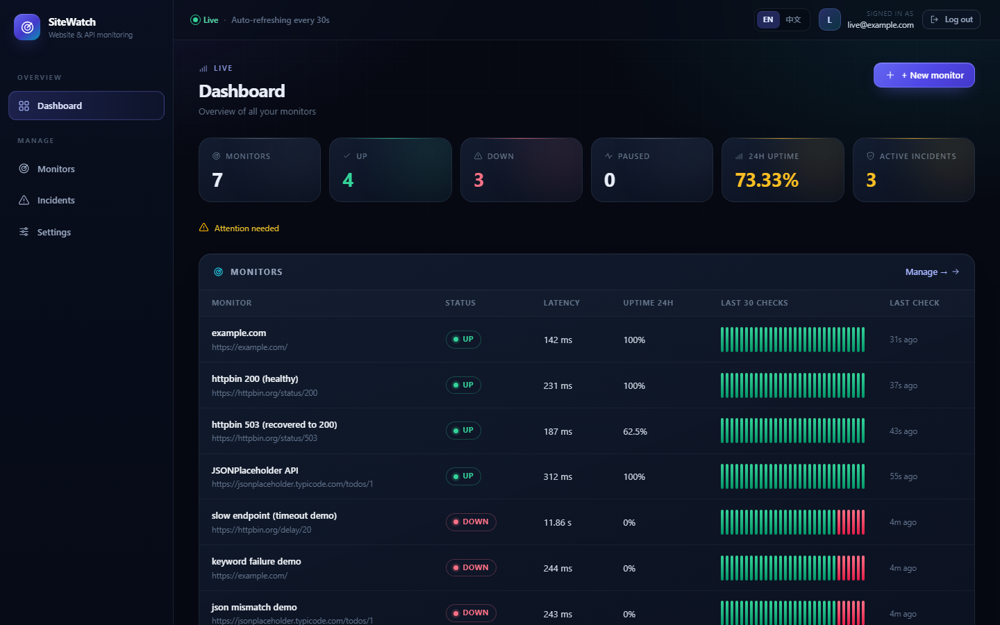
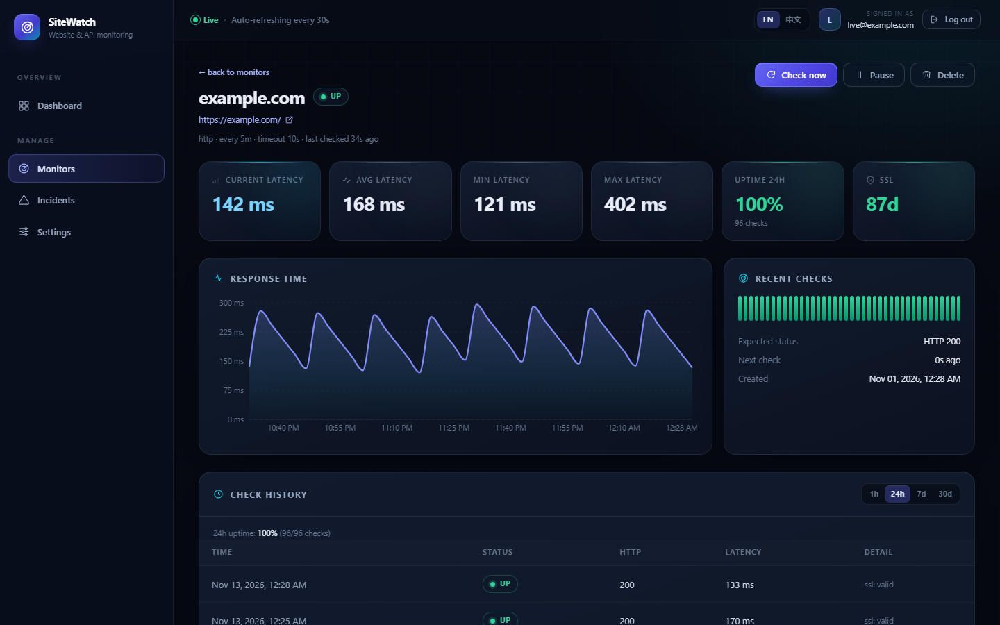
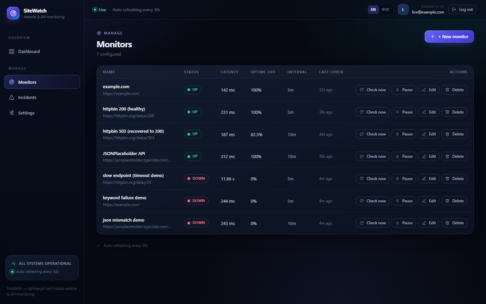
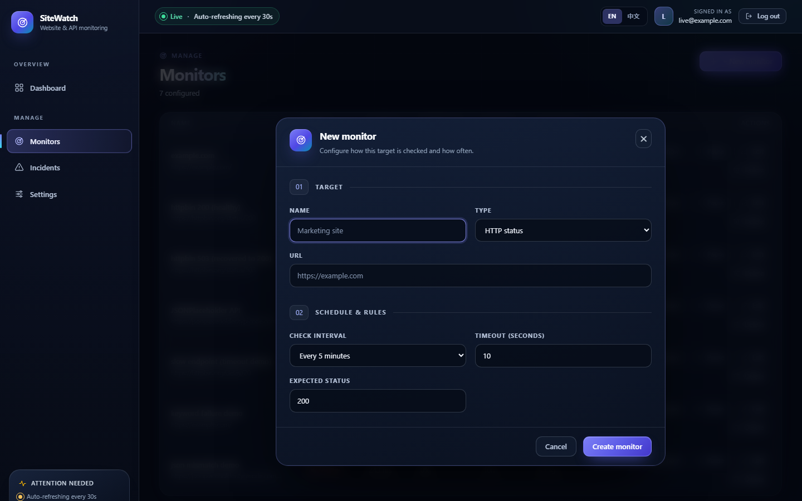
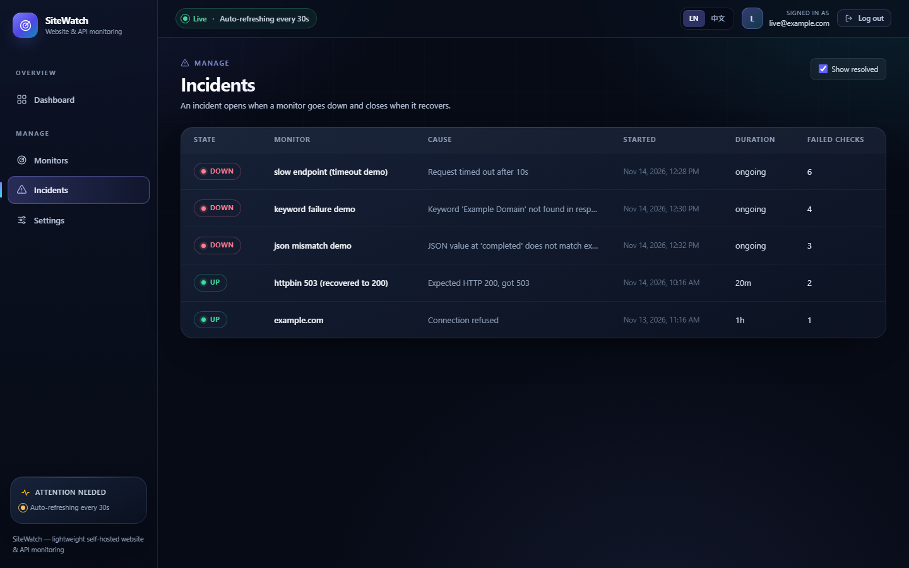
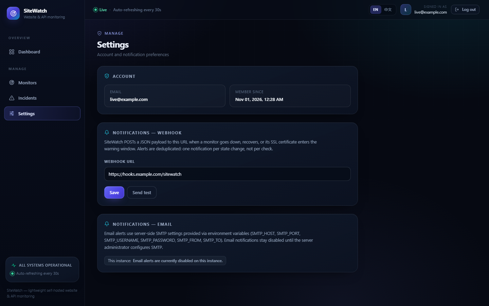
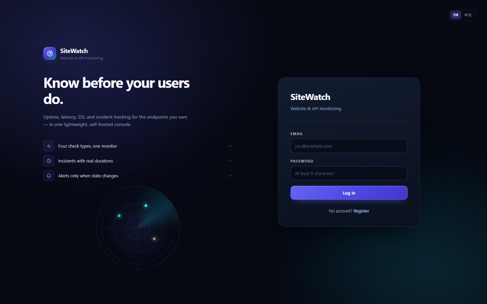
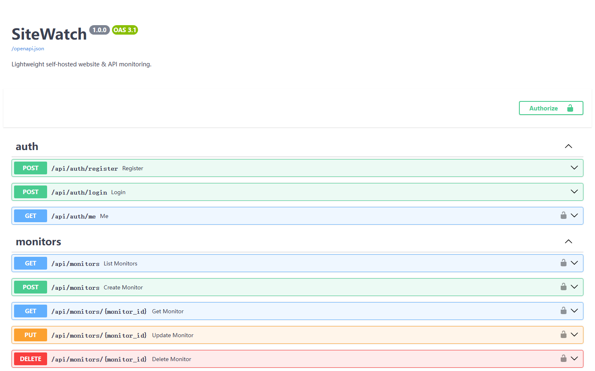

# SiteWatch

[](https://github.com/taozhihaoo/website-api-monitor/actions/workflows/ci.yml)

**English (default)** · [简体中文](README.zh-CN.md)

A lightweight, **self-hosted monitoring platform for websites and APIs**: scheduled
checks, uptime history, response-time tracking, SSL certificate monitoring,
incident tracking, alerts (webhook + email), and a polished bilingual web console.

Single process, single instance by design — small enough to run on one VPS, with
no Redis, Celery or external service required.

```bash
cp .env.example .env    # set SECRET_KEY and POSTGRES_PASSWORD
docker compose up -d    # → http://localhost:8080 (API docs: /docs)
```

## Screenshots

Every image below is captured from the **real running English UI** with a
deterministic demo dataset via `cd frontend && npm run screenshots`. The Chinese
equivalents are in [docs/screenshots/zh/](docs/screenshots/zh/) and are used only
by the [Chinese README](README.zh-CN.md). The demo data intentionally includes
broken monitors so DOWN states and incidents are visible.

| Dashboard | Monitor detail |
|---|---|
|  |  |

| Monitors | Create monitor |
|---|---|
|  |  |

| Incidents | Settings |
|---|---|
|  |  |

| Login |
|---|
|  |

Interactive API documentation (Swagger UI, English only):


## Highlights

- **Refined dark console** — aurora canvas, elevated glass surfaces, tone-tinted
  stat tiles with inline icon set, a full-width system-health banner, gradient
  page titles, animated status dots and a responsive sidebar. Hand-built design
  system on Tailwind 4, no UI framework.
- **Accessible by construction** — WCAG-AA text contrast, visible
  `:focus-visible` rings (also in forced-colors mode), a real modal focus trap
  with Escape / scroll lock / focus restoration, labelled form errors, and
  `prefers-reduced-motion` support.
- **English + 简体中文 UI** — the top-bar switch translates the entire interface,
  including validation messages, relative times ("in 5m" / "5 分钟后"), chart
  tooltips and SSL/status labels. English is the default; the choice persists in
  `localStorage`.
- **Evidence-driven docs** — both READMEs are independent files, each showing
  only screenshots of its own language.

## Features

- **Four check types**, combinable on one monitor:
  - **HTTP** — status-code checks with a configurable expected status
  - **Keyword** — body must contain / not contain a string (HTTP 200 + keyword fail ⇒ **DOWN**)
  - **API JSON** — safe dot-path extraction (`data.items.0.status`) with JSON-aware
    expected-value comparison (no `eval`; `false` matches `false`, `3` matches `3`)
  - **SSL** — certificate expiry via TLS handshake (`ssl`-only monitors, or a sidecar on HTTPS monitors)
- **Scheduler** — every enabled monitor is checked on its interval (60s–24h);
  `next_check_at` is persisted so restarts are safe; dispatch is bounded by the
  worker pool; one failing monitor never blocks others and failed workers are
  re-queued instead of silently waiting a full interval
- **History & uptime** — every check is persisted; uptime % for 1h/24h/7d/30d;
  latency avg/min/max; 30-day retention (configurable). The detail page's window
  selector drives both the uptime card and the history table
- **Incidents** — opens on UP→DOWN, extends while DOWN, closes on recovery, with
  failure counts and duration. A partial unique database index plus per-monitor
  check serialization guarantee **one open incident per monitor**. Pausing a
  monitor closes its open incident, so a paused DOWN target cannot leave a
  zombie incident that inflates the dashboard forever
- **Alerts** — webhook (per-user URL) and email (SMTP via env), deduplicated to
  one alert per state change. Every dispatch attempt is audited in the
  `notifications` table
- **Auth** — local accounts (bcrypt), JWT bearer tokens, per-user isolation
  (other users' monitors return 404)
- **Security** — SSRF guard on every URL the server contacts, bounded response
  size / retries / redirects, and execution-time re-validation (see [Security](#security))

## Architecture

```
Browser (React SPA) ──▶ nginx (frontend container: static files + /api, /health, /docs proxy)
                              │
                              ▼
                     FastAPI backend (single process)
                       ├── REST API (routes → services, no logic in routes)
                       ├── Scheduler (daemon thread: scans due monitors)
                       │     └── Check Engine (bounded pool, per-monitor lock)
                       │           ├── HTTPChecker (httpx, SSRF-guarded hops)
                       │           ├── KeywordRule / JSONRule (pure functions)
                       │           └── SSLChecker (TLS handshake + X.509)
                       ├── Incident state machine (UP→DOWN→UP)
                       └── Notifications (webhook/email, transition-gated)
                              │
                              ▼
                        PostgreSQL (SQLAlchemy 2.x + Alembic migrations)
```

Check execution is separated from scheduling; business logic lives in services;
routes only handle HTTP concerns. See [docs/DESIGN.md](docs/DESIGN.md) for the
full pre-implementation design document.

## Tech Stack

| Layer | Choices |
|---|---|
| Backend | Python 3.11+, FastAPI, Pydantic v2, SQLAlchemy 2.x (sync), Alembic, httpx, PyJWT, bcrypt, cryptography |
| Database | PostgreSQL 16 (SQLite supported for local dev/tests) |
| Scheduler | Custom single-process scan loop + `ThreadPoolExecutor` (no Celery/Redis) |
| Frontend | React 18, TypeScript, Vite, Tailwind CSS 4, TanStack Query, react-router, Recharts |
| i18n | Typed in-repo dictionaries (`en` / `zh`) with compile-time key-parity checks |
| Tests | pytest (+httpx MockTransport), Vitest + Testing Library, Playwright E2E |
| Infra | Docker + docker-compose (backend / frontend-nginx / postgres), GitHub Actions CI |

Deliberately **not** included: Celery, Redis, Kafka, Kubernetes, microservice
splits — this is a small, complete product, not a distributed system.

## Requirements

- Docker + docker-compose (recommended), **or**
- Python 3.11+ and Node 22+ for running from source

## Quick Start (Docker)

```bash
cp .env.example .env
# .env: set SECRET_KEY (python -c "import secrets; print(secrets.token_urlsafe(48))")
#       set POSTGRES_PASSWORD (any characters, including @ : / # — they are
#       percent-encoded by the backend, not pasted into a URL string)
docker compose up -d --build
open http://localhost:8080
```

- **backend** runs `alembic upgrade head && uvicorn app.main:app` (schema is
  created only by migrations), as a non-root user, with a `/health` healthcheck
- **frontend** is a multi-stage build (node → nginx:alpine) serving the SPA and
  proxying `/api`, `/health`, `/docs`, `/redoc` and `/openapi.json` to the backend
  (single origin, no CORS in prod)
- **postgres** uses a named volume and a `pg_isready` healthcheck; the backend
  waits for it, and nginx waits for the backend
- Connection settings are passed as discrete `POSTGRES_*` variables and
  assembled with SQLAlchemy's `URL.create()`, so a password containing URL
  delimiters cannot corrupt the hostname

> The local development machine had no Docker daemon, but the **CI `docker` job
> builds both images and boots the entire compose stack on every push**, then
> verifies `/health`, `/`, `/openapi.json` and `/docs` through nginx. The compose
> path is therefore exercised in CI rather than merely asserted.

## Quick Start (from source)

```bash
# 1. Backend (SQLite locally by default — no Postgres needed to try it)
cd backend
python -m venv .venv && source .venv/bin/activate      # Windows: .venv\Scripts\activate
pip install -e ".[dev]"
export APP_ENV=development
alembic upgrade head
uvicorn app.main:app --reload --port 8000              # API on :8000, docs on /docs

# 2. Frontend (dev server proxies /api to :8000)
cd ../frontend
npm install
npm run dev                                            # UI on http://localhost:5173

# 3. (optional) Demo data
cd ../backend
python -m app.seed
```

## Configuration

All configuration is via environment variables (see [.env.example](.env.example)):

| Variable | Default | Purpose |
|---|---|---|
| `SECRET_KEY` | *(required in production)* | JWT signing key; development uses a per-process random key |
| `DATABASE_URL` | `sqlite:///./sitewatch.db` | any SQLAlchemy URL; overrides the `POSTGRES_*` parts |
| `POSTGRES_HOST/PORT/USER/PASSWORD/DB` | unset | discrete connection parts used by compose; password is URL-encoded safely |
| `APP_ENV` | `development` | `production` refuses a missing/empty secret |
| `MAX_MONITORS_PER_USER` | `50` | per-account monitor limit |
| `MAX_CONCURRENT_CHECKS` | `10` | scheduler worker pool size and per-scan dispatch cap |
| `SCHEDULER_SCAN_INTERVAL_SECONDS` | `10` | due-scan cadence |
| `CHECK_MAX_RETRIES` | `2` | bounded retries, exponential backoff (transport errors only) |
| `MAX_RESPONSE_BYTES` | `2000000` | response body cap per check |
| `RETENTION_DAYS` | `30` | check-history pruning |
| `WEBHOOK_ALLOW_PRIVATE_IPS` | `false` | allow webhook targets on private networks |
| `SMTP_HOST/PORT/USERNAME/PASSWORD/FROM/TO` | empty | email alerts; empty = disabled |
| `ACCESS_TOKEN_EXPIRE_MINUTES` | `10080` | JWT lifetime (7 days) |

## Authentication

- `POST /api/auth/register` → 201 (email + password ≥ 8 chars)
- `POST /api/auth/login` → `{access_token, token_type: "bearer"}`
- `GET /api/auth/me` with `Authorization: Bearer <token>` (also reports `smtp_enabled`)

Passwords are bcrypt-hashed (never stored plaintext, never logged). Tokens are
HS256 JWTs. Unknown-email logins perform the same bcrypt work as wrong-password
logins to avoid timing-based account enumeration. There is no OAuth/RBAC by design.

## Creating a Monitor

In the UI: **Monitors → + New monitor**. Via API: `POST /api/monitors` with
`name`, `target_url`, `type` (`http` | `keyword` | `api_json` | `ssl`),
`interval_seconds` (60–86400), `timeout_seconds` (1–30), `expected_status`, plus
type-specific fields (`keyword`+`keyword_mode`, `json_path`+`json_expected_value`,
`ssl_check_enabled`+`ssl_warning_days`).

Every target URL is validated at creation **and at request time**. Changing
`target_url` or the monitor type clears cached SSL data and re-arms SSL alerting
so a new certificate cannot be hidden by stale dedup state. Blank optional
fields are normalised identically on create and update.

## Monitor Types & Status Rules

| Situation | Resulting status |
|---|---|
| HTTP status ≠ `expected_status` | DOWN (`status_mismatch`) |
| Timeout / connection / DNS / TLS error | DOWN (with `error_type`) |
| Keyword not contained (or contained, in `not_contains` mode) | **DOWN** (`keyword_failed`) — HTTP 200 does not save you |
| JSON unparseable / path missing / value mismatch | DOWN (`json_parse_failed` / `json_failed`) |
| `ssl`-type monitor with expired certificate | DOWN (`ssl_expired`) |
| SSL sidecar on an HTTP monitor expiring | monitor stays UP; separate `ssl_expiring`/`ssl_expired` alerts |
| `http://` target with SSL sidecar | `not_applicable` |

`GET /api/ssl/{id}?refresh=true` is rejected with `400 ssl_check_disabled` when
SSL checking is off for that monitor — otherwise it would write a frozen
certificate snapshot that scheduled checks never update, silently suppressing
future expiry alerts.

## Alerts

Channels: **webhook** (per-user URL, Settings page, "Send test" button) and
**email** (server-wide SMTP via env; disabled unless fully configured). Blank
webhook input is stored as `null` (disabled), never as an empty string.

```json
{
  "event": "monitor_down",
  "monitor": {"id": 1, "name": "Example", "url": "https://example.com", "type": "http"},
  "status": "down",
  "incident": {"id": 3, "started_at": "...", "cause": "Expected HTTP 200, got 503", "failure_count": 1},
  "timestamp": "2026-09-30T12:00:00+00:00"
}
```

Events: `monitor_down`, `recovered`, `ssl_expiring`, `ssl_expired` (+ `test`).
**Deduplication:** one `monitor_down` per incident, one `recovered` on
resolution, one SSL alert per state transition. DOWN→DOWN checks send nothing.
Email header values are sanitised and every failure is recorded as a `failed`
notification row instead of escaping the audit trail.

## Uptime & History

- `GET /api/monitors/{id}/checks?hours=1|24|168|720&limit=&offset=` (paginated, newest first)
- `GET /api/monitors/{id}/uptime?window=1h|24h|7d|30d` — only checks that exist in
  the window are counted (no future projection)
- Retention: checks older than `RETENTION_DAYS` are pruned daily; a failed pass
  is retried on the next scan
- The dashboard, detail page and history all poll so background scheduler checks
  appear without a reload

## REST API

Interactive docs: `/docs` (Swagger UI, also reachable through the nginx proxy in
Docker). Endpoints:

```
GET    /health
POST   /api/auth/register            POST /api/auth/login          GET /api/auth/me
PUT    /api/me/notifications         POST /api/me/notifications/test
GET    /api/monitors                 POST /api/monitors
GET    /api/monitors/{id}            PUT  /api/monitors/{id}       DELETE /api/monitors/{id}
POST   /api/monitors/{id}/check      POST /api/monitors/{id}/enable
POST   /api/monitors/{id}/disable
GET    /api/monitors/{id}/checks     GET  /api/monitors/{id}/uptime
GET    /api/monitors/{id}/incidents  GET  /api/incidents?active=true
GET    /api/dashboard/summary        GET  /api/ssl/{monitor_id}?refresh=true
```

Errors use one envelope and never leak tracebacks or DB details:

```json
{"error": {"code": "not_found", "message": "Monitor not found"}}
```

## Internationalization

The UI ships two complete dictionaries in
[`frontend/src/i18n/messages.ts`](frontend/src/i18n/messages.ts). Chinese is
typed as `Record<keyof typeof en, string>`, so a missing translation fails
`npm run typecheck` in CI. Switch with the **EN / 中文** toggle in the top bar or
on the login screen; the preference is stored in
`localStorage["sitewatch_locale"]` and `<html lang>` is updated accordingly.
Server-side data (monitor names, incident causes, API error messages) is not
translated — it belongs to the user or the monitored system.

To regenerate all screenshots after a UI change:

```bash
cd frontend && npm run screenshots
```

This starts a local Vite server, drives a headless Chromium through a
deterministic demo dataset (no backend or external network required), respects
the API's query parameters, fails on any console/page error, and writes
`docs/screenshots/en/*.png`, `docs/screenshots/zh/*.png` and
`docs/screenshots/screenshots.json`.

## Security

> This section is kept in English by convention, consistent with the Chinese README.

SiteWatch fetches URLs on command, so SSRF is treated seriously:

- Scheme restricted to `http`/`https`; embedded credentials and control
  characters rejected (control chars used to be silently stripped by
  `urlsplit` but rejected later by httpx, producing a bogus `internal_error` DOWN)
- Hosts are checked with **standard `ipaddress` parsing of resolved addresses**
  (not string matching): loopback, private (10/8, 172.16/12, 192.168/16, CGNAT),
  link-local incl. cloud metadata (`169.254.169.254`), multicast, reserved,
  unspecified and IPv6 equivalents (`::1`, `fe80::/10`, `fc00::/7`,
  IPv4-mapped `::ffff:10.0.0.1`) are all rejected
- Literal IP targets are parsed directly and never resolved via DNS
- Malformed IPv6 literals and non-numeric / out-of-range ports are rejected
  with a clean `400 invalid_url` instead of escaping as a 500
- Redirects are followed manually (max 5) and **re-validated at every hop**
- **TLS/SSL paths re-validate the target at execution time**, not just at monitor
  creation, so a hostname re-pointed to a private address cannot be reached via
  an `ssl`-only monitor or `/api/ssl/{id}?refresh=true`
- Webhook URLs go through the same guard (`WEBHOOK_ALLOW_PRIVATE_IPS=true`
  opts a self-hosted admin out, deliberately); empty webhook input is normalised
  to `null`
- Additional hardening: per-check timeout, bounded retries with backoff,
  2 MB response cap, custom `User-Agent`, parameterized queries only
  (SQLAlchemy), bcrypt password hashing, constant-work login for unknown
  accounts, JWT secret from env (no hardcoded default; development uses a
  per-process random key), unified error envelope, per-user monitor cap
- No shared exception instances are re-raised (avoids traceback-frame retention)

**Known limitation:** the hostname is re-resolved by the HTTP client after the
guard validates it, so a DNS-rebinding race is mitigated but not eliminated (no
connect-IP pinning). Acceptable for a self-hosted single-tenant tool; documented
honestly rather than hidden. Access tokens are valid for 7 days and logout only
clears the client-side token (there is no server-side revocation list) — do not
share an instance with untrusted users.

## Testing

```bash
cd backend  && python -m pytest -q          # 262 tests
cd frontend && npm test                     # 49 unit tests
cd frontend && npx playwright test          # 12 E2E tests
python scripts/check_docs.py                # README + screenshot validation
```

- Backend: fully offline — HTTP via `httpx.MockTransport`, SSL via a fake
  certificate provider, DNS via a stubbed resolver. Covers auth, CRUD and
  validation, the SSRF guard (incl. control chars), checkers, keyword/JSON/SSL
  rules, incident transitions and duplicate-open-incident recovery, notification
  dedup and email failure auditing, uptime math, retention, scheduler semantics
  and restart, pagination, ownership isolation, DB URL encoding and SSL refresh
  guards
- Frontend: Vitest + Testing Library — auth validation, dashboard, monitor list
  and form validation, badges, uptime strip, formatters (incl. future relative
  times), private-host detection, hidden-field validation, i18n dictionary
  parity, locale switching, query-cache keys, window→hours mapping and the
  incidents filter
- **E2E (Playwright)**: 12 tests against the real running stack (vite dev server
  → API → database, no mocks): register → dashboard, invalid login, logout/login,
  monitor creation, form validation, private-URL rejection, manual check with
  history polling, incident open → recovery → duration, disable/pause, delete
  with confirmation, a 404-monitor error state, and the EN/中文 language switch

## CI

`.github/workflows/ci.yml` — five jobs, no external secrets:

| Job | What it verifies |
|---|---|
| `backend` | Python 3.11 + 3.13 matrix against a real Postgres 16: ruff, migration upgrade→downgrade→upgrade, full pytest suite |
| `frontend` | `npm ci`, typecheck (also enforces en/zh key parity), Vitest, production build |
| `docs` | both READMEs, localized screenshot assets and the screenshot manifest |
| `docker` | `docker compose config`, builds both images, boots the real stack with a deliberately URL-hostile `POSTGRES_PASSWORD`, smoke-tests `/health`, `/`, `/openapi.json` and `/docs` through nginx, then tears down |
| `e2e` | Playwright against the real stack |

## Demo

```bash
cd backend
APP_ENV=development python -m app.seed
```

Creates `demo@sitewatch.local` (password from `DEMO_PASSWORD`, or generated and
printed once) and four monitors: example.com (HTTP+keyword+SSL), httpbin 200,
**httpbin 503 (permanently down — demonstrates DOWN + incident + alert-once)**,
and a JSONPlaceholder JSON health check. Seed monitors are due immediately;
re-seeding repairs older rows with a `NULL` `next_check_at`. Seed refuses to run
with `APP_ENV=production`.

## Project Structure

```
├── backend/
│   ├── app/{api,schemas,services,monitoring,notifications,scheduler,models}
│   ├── alembic/versions/      # 0001 initial schema, 0002 one-open-incident index
│   ├── tests/                 # pytest suite (offline)
│   └── Dockerfile
├── frontend/
│   ├── src/{api,auth,components,i18n,pages,utils}
│   ├── tests/  e2e/  scripts/ # vitest, Playwright, screenshot capture
│   ├── nginx.conf  Dockerfile
├── docs/screenshots/{en,zh}   # localized UI screenshots
├── scripts/check_docs.py      # README + asset validation (used in CI)
├── README.md                  # English (default)
├── README.zh-CN.md            # 简体中文
├── docs/DESIGN.md             # pre-implementation design
├── docker-compose.yml
└── .github/workflows/ci.yml
```

## Limitations

Stated plainly:

- **Single-instance scheduler** — run exactly one backend process per database;
  no distributed workers, no HA
- **PostgreSQL in production** (SQLite is fine for trying it out locally)
- **Public HTTP/HTTPS monitoring only** — no browser-level/transaction checks,
  no ICMP/TCP/DNS check types
- **No teams / RBAC / OAuth** — one account = one user
- **No token revocation list** — logout is client-side only (see Security)
- **No Kubernetes, no message queues** — intentional
- Email alerts need any SMTP account; no other paid external service is required
- DNS-rebinding TOCTOU is mitigated, not eliminated (see Security)
- UI is translated; server-side values (monitor names, causes, API errors) are not

## License

> This section is kept in English by convention, consistent with the Chinese README.

Released under the **MIT License**. See [LICENSE](LICENSE) for the full text.

```
MIT License

Copyright (c) 2026 SiteWatch contributors

Permission is hereby granted, free of charge, to any person obtaining a copy
of this software and associated documentation files (the "Software"), to deal
in the Software without restriction, including without limitation the rights
to use, copy, modify, merge, publish, distribute, sublicense, and/or sell
copies of the Software, and to permit persons to whom the Software is
furnished to do so, subject to the following conditions:

The above copyright notice and this permission notice shall be included in all
copies or substantial portions of the Software.

THE SOFTWARE IS PROVIDED "AS IS", WITHOUT WARRANTY OF ANY KIND, EXPRESS OR
IMPLIED, INCLUDING BUT NOT LIMITED TO THE WARRANTIES OF MERCHANTABILITY,
FITNESS FOR A PARTICULAR PURPOSE AND NONINFRINGEMENT. IN NO EVENT SHALL THE
AUTHORS OR COPYRIGHT HOLDERS BE LIABLE FOR ANY CLAIM, DAMAGES OR OTHER
LIABILITY, WHETHER IN AN ACTION OF CONTRACT, TORT OR OTHERWISE, ARISING FROM,
OUT OF OR IN CONNECTION WITH THE SOFTWARE OR THE USE OR OTHER DEALINGS IN THE
SOFTWARE.
```
