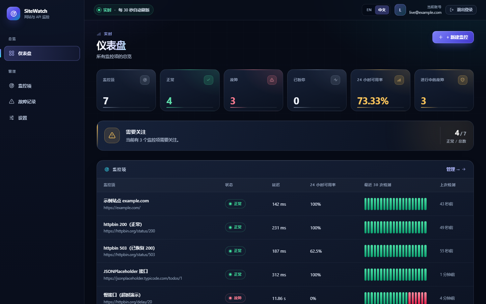
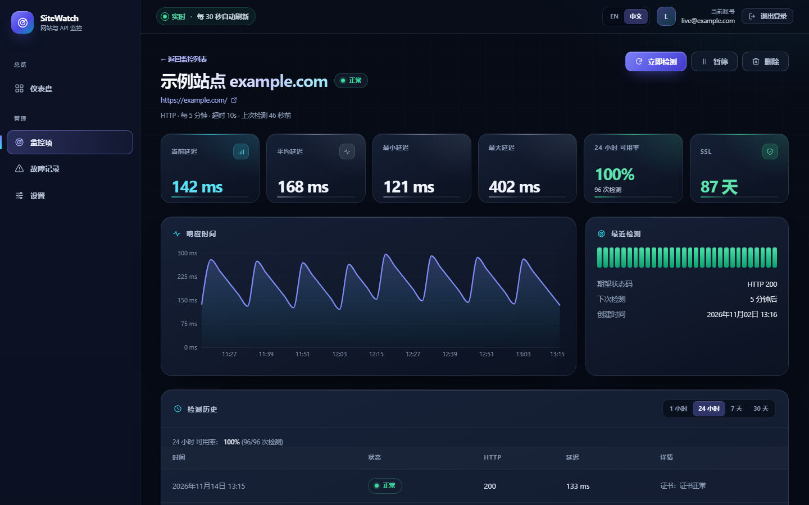
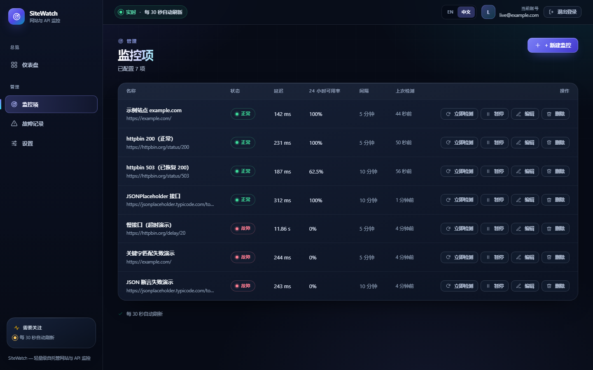
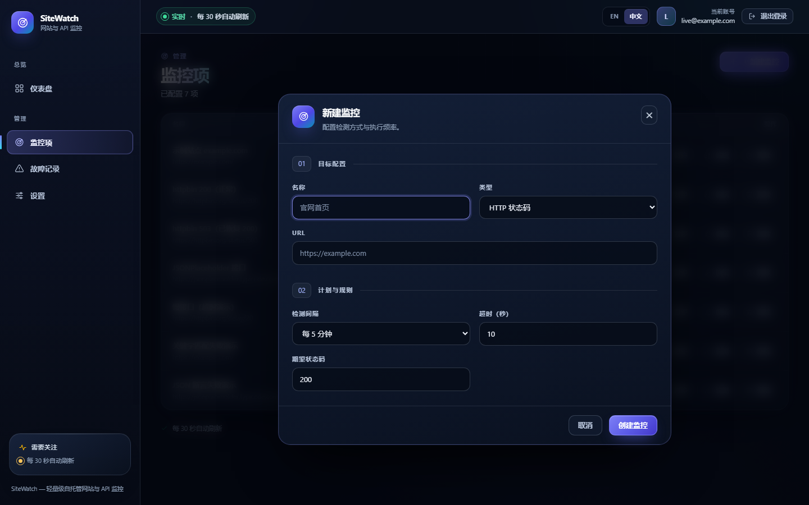
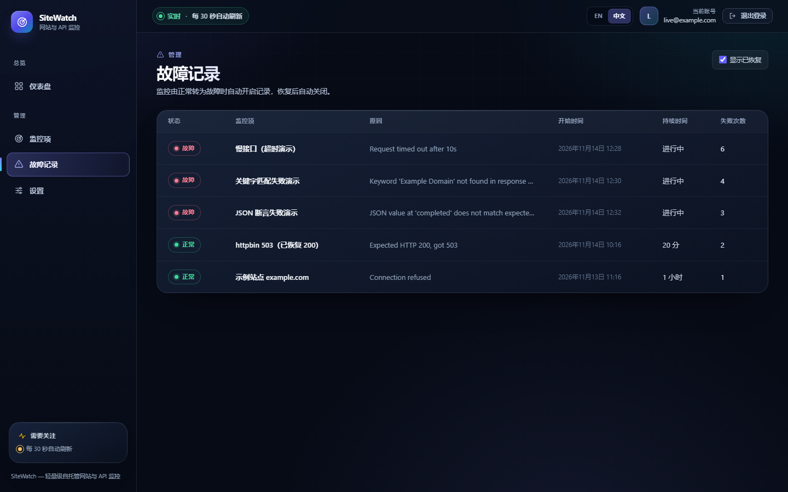
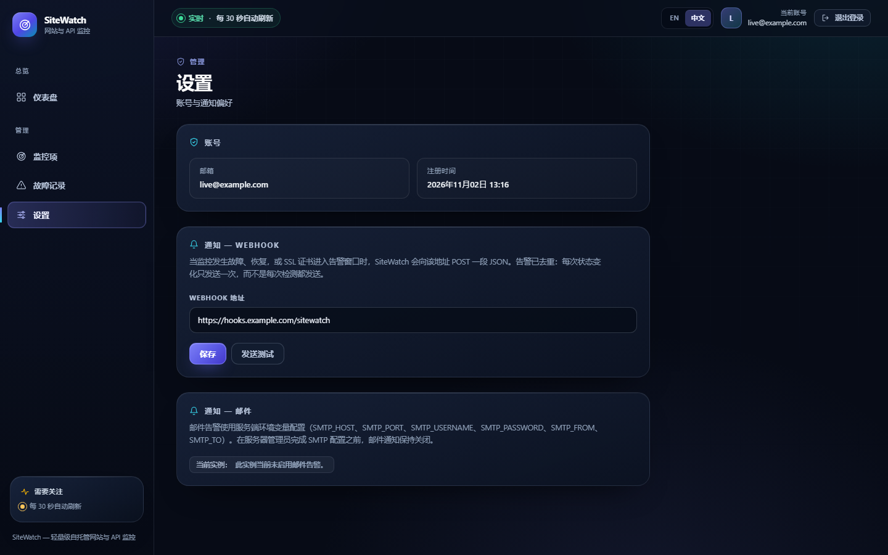
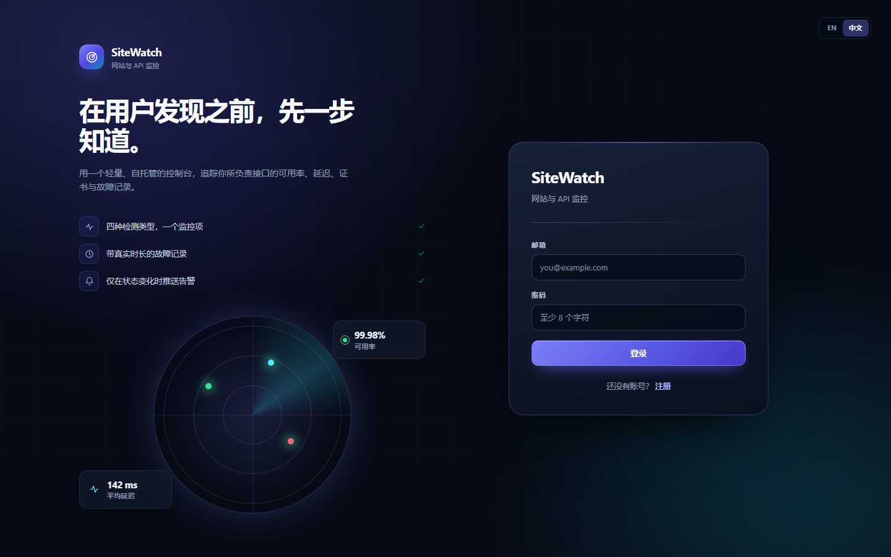

# SiteWatch

[](https://github.com/taozhihaoo/website-api-monitor/actions/workflows/ci.yml)

[English (default)](README.md) · **简体中文**

一个轻量级、**可自托管的网站与 API 监控平台**：定时检测、可用率历史、响应时间追踪、SSL 证书监控、故障记录、告警（Webhook / 邮件），以及一套精致的中英双语 Web 控制台。

刻意采用单进程、单实例架构——一台小型 VPS 即可运行，不需要 Redis、Celery 或任何外部服务。

```bash
cp .env.example .env    # 填写 SECRET_KEY 与 POSTGRES_PASSWORD
docker compose up -d    # → http://localhost:8080（API 文档：/docs）
```

## 界面截图

以下均为**真实运行的中文界面**截图，由固定演示数据集通过 `cd frontend && npm run screenshots` 自动生成。英文版本位于 [docs/screenshots/en/](docs/screenshots/en/)，仅由[英文 README](README.md) 引用。演示数据刻意包含故障监控项，用于展示 DOWN 状态与故障记录。

| 仪表盘 | 监控详情 |
|---|---|
|  |  |

| 监控列表 | 新建监控 |
|---|---|
|  |  |

| 故障记录 | 设置 |
|---|---|
|  |  |

| 登录 |
|---|
|  |

> 交互式 API 文档（Swagger UI）与 CI 运行截图为英文界面，按语言一致原则仅在英文 README 中展示；本文件只引用中文界面截图。

## 项目亮点

- **重新设计的深色控制台**：极光背景、抬升式玻璃卡片、按状态着色的指标卡与手写内联图标、整幅系统健康横幅、渐变页面标题、动态状态指示点与响应式侧边栏。基于 Tailwind 4 自建设计系统，未引入 UI 组件库。
- **可访问性落到细节**：正文对比度达到 WCAG AA，全局 `:focus-visible` 焦点环（含 Windows 高对比度模式），弹窗实现了真正的焦点陷阱、Esc 关闭、背景滚动锁定与焦点归还，表单错误与控件关联，并支持「减少动态效果」系统偏好。
- **中英文完整双语界面**：顶栏开关会切换整站文案，包括校验提示、相对时间（「5 分钟后」/「in 5m」）、图表提示框与 SSL / 状态标签。默认英文，选择会保存在 `localStorage` 中。
- **有据可查的文档**：两份 README 互相独立，各自只引用与自身语言一致的界面截图。

## 功能特性

- **四种检测类型**（可组合在同一个监控项上）：
  - **HTTP** —— 校验状态码，可配置期望状态码
  - **关键字** —— 响应体必须包含 / 不得包含指定字符串（HTTP 200 但关键字不匹配仍判定为 **故障**）
  - **API JSON** —— 安全的点路径取值（`data.items.0.status`）与按 JSON 类型比较的期望值（不使用 `eval`；`false` 匹配 `false`，`3` 匹配 `3`）
  - **SSL** —— 通过 TLS 握手读取证书到期时间（独立 `ssl` 监控，或 HTTPS 监控的附加检测）
- **调度器** —— 按每个监控项的间隔（60 秒～24 小时）执行；`next_check_at` 持久化，重启后可恢复；单轮派发数量受工作线程池上限约束；单个监控失败不会阻塞其他任务；执行失败的监控会被重新入队，而不是静默等待一整个周期
- **历史与可用率** —— 每次检测都会落库；提供 1 小时 / 24 小时 / 7 天 / 30 天可用率、延迟平均值 / 最小值 / 最大值；默认保留 30 天（可配置）。详情页的时间窗口同时驱动可用率卡片与历史表格
- **故障记录** —— 正常→故障时开启、故障期间累计、恢复后关闭，记录失败次数与持续时长。数据库层的部分唯一索引配合按监控项串行化，保证**同一监控最多只有一条未恢复故障**。**暂停监控会同时关闭其未恢复故障**，避免长期停机的目标留下永久「僵尸故障」，使仪表盘的活动故障数永远虚高
- **告警** —— Webhook（每个用户独立配置）与邮件（服务端 SMTP 环境变量），**按状态变化去重**。每次派发尝试都会写入 `notifications` 表以便审计
- **账号体系** —— 本地账号（bcrypt 哈希）、JWT Bearer Token；数据按用户隔离，访问他人监控返回 404
- **安全** —— 服务端请求的每个 URL 都经过 SSRF 防护（见 [Security](#security)），并限制响应体大小、重试次数、超时与跳转次数，且在执行时二次校验

## 架构

```
浏览器 (React SPA) ──▶ nginx（前端容器：静态文件 + /api、/health、/docs 反向代理）
                              │
                              ▼
                     FastAPI 后端（单进程）
                       ├── REST API（routes → services，路由不含业务逻辑）
                       ├── 调度器（后台线程：扫描到期监控）
                       │     └── 检测引擎（有界线程池 + 按监控项加锁）
                       │           ├── HTTPChecker（httpx、SSRF 防护、逐跳校验）
                       │           ├── KeywordRule / JSONRule（纯函数）
                       │           └── SSLChecker（TLS 握手 + X.509）
                       ├── 故障状态机（正常→故障→正常）
                       └── 通知（Webhook / 邮件，仅状态跃迁时触发）
                              │
                              ▼
                        PostgreSQL（SQLAlchemy 2.x + Alembic 迁移）
```

检测执行与调度分离，业务逻辑集中在 services，路由只处理 HTTP 层。完整的前期设计文档见 [docs/DESIGN.md](docs/DESIGN.md)。

## 技术栈

| 层 | 选型 |
|---|---|
| 后端 | Python 3.11+、FastAPI、Pydantic v2、SQLAlchemy 2.x（同步）、Alembic、httpx、PyJWT、bcrypt、cryptography |
| 数据库 | PostgreSQL 16（本地开发与测试可用 SQLite） |
| 调度器 | 自研单进程扫描循环 + `ThreadPoolExecutor`（不使用 Celery / Redis） |
| 前端 | React 18、TypeScript、Vite、Tailwind CSS 4、TanStack Query、react-router、Recharts |
| 国际化 | 仓库内类型化字典（`en` / `zh`），编译期校验键完整性 |
| 测试 | pytest（httpx MockTransport）、Vitest + Testing Library、Playwright E2E |
| 基础设施 | Docker + docker-compose（backend / frontend-nginx / postgres）、GitHub Actions CI |

刻意**不引入**：Celery、Redis、Kafka、Kubernetes、微服务拆分——这是一个小而完整的产品，不是分布式系统。

## 运行环境

- 推荐：Docker + docker-compose
- 或：Python 3.11+ 与 Node 22+（源码运行）

## 快速开始（Docker）

```bash
cp .env.example .env
# .env 中填写 SECRET_KEY（python -c "import secrets; print(secrets.token_urlsafe(48))"）
#             与 POSTGRES_PASSWORD（可包含 @ : / # 等任意字符，后端会做百分号编码，
#             而不是把密码直接拼进 URL 字符串）
docker compose up -d --build
open http://localhost:8080
```

- **backend** 容器执行 `alembic upgrade head && uvicorn app.main:app`（表结构只由迁移创建），以非 root 用户运行，提供 `/health` 健康检查
- **frontend** 容器：多阶段构建（node → nginx:alpine），托管 SPA，并把 `/api`、`/health`、`/docs`、`/redoc`、`/openapi.json` 反向代理到后端（同源，生产环境无需 CORS）
- **postgres**：命名卷 + `pg_isready` 健康检查；后端等待数据库就绪，nginx 等待后端就绪
- 连接信息以独立的 `POSTGRES_*` 变量传入，由 SQLAlchemy `URL.create()` 组装，密码中的 URL 保留字符不会破坏主机名解析

> 本地开发环境没有 Docker 守护进程，但 **CI 的 `docker` 任务会在每次推送时构建两个镜像并真实启动整套 compose 栈**，通过 nginx 验证 `/health`、`/`、`/openapi.json` 与 `/docs`。也就是说 compose 路径由 CI 实际覆盖，而非仅作声明。

## 快速开始（源码运行）

```bash
# 1. 后端（本地默认使用 SQLite，无需 Postgres 即可体验）
cd backend
python -m venv .venv && source .venv/bin/activate      # Windows: .venv\Scripts\activate
pip install -e ".[dev]"
export APP_ENV=development
alembic upgrade head
uvicorn app.main:app --reload --port 8000              # API: :8000，文档: /docs

# 2. 前端（开发服务器把 /api 代理到 :8000）
cd ../frontend
npm install
npm run dev                                            # 界面: http://localhost:5173

# 3.（可选）演示数据
cd ../backend
python -m app.seed
```

## 配置

所有配置均通过环境变量提供（见 [.env.example](.env.example)）：

| 变量 | 默认值 | 用途 |
|---|---|---|
| `SECRET_KEY` | *（生产必填）* | JWT 签名密钥；开发模式使用进程级随机密钥 |
| `DATABASE_URL` | `sqlite:///./sitewatch.db` | 任意 SQLAlchemy URL；设置后优先于 `POSTGRES_*` |
| `POSTGRES_HOST/PORT/USER/PASSWORD/DB` | 未设置 | compose 使用的离散连接参数；密码会被安全编码 |
| `APP_ENV` | `development` | `production` 时拒绝缺失或空的密钥 |
| `MAX_MONITORS_PER_USER` | `50` | 每个账号的监控项上限 |
| `MAX_CONCURRENT_CHECKS` | `10` | 调度器线程池大小，也是单轮派发上限 |
| `SCHEDULER_SCAN_INTERVAL_SECONDS` | `10` | 到期扫描周期 |
| `CHECK_MAX_RETRIES` | `2` | 有界重试，指数退避（仅传输错误） |
| `MAX_RESPONSE_BYTES` | `2000000` | 单次检测响应体上限 |
| `RETENTION_DAYS` | `30` | 检测历史保留天数 |
| `WEBHOOK_ALLOW_PRIVATE_IPS` | `false` | 是否允许 Webhook 指向内网 |
| `SMTP_HOST/PORT/USERNAME/PASSWORD/FROM/TO` | 空 | 邮件告警；留空即关闭 |
| `ACCESS_TOKEN_EXPIRE_MINUTES` | `10080` | JWT 有效期（7 天） |

## 账号与认证

- `POST /api/auth/register` → 201（邮箱 + 至少 8 位密码）
- `POST /api/auth/login` → `{access_token, token_type: "bearer"}`
- `GET /api/auth/me`（请求头 `Authorization: Bearer <token>`，同时返回 `smtp_enabled`）

密码使用 bcrypt 哈希存储，绝不以明文保存或写入日志；令牌为 HS256 JWT。邮箱不存在时同样执行一次 bcrypt 校验，避免通过响应时间枚举已注册账号。按设计不提供 OAuth / RBAC。

## 创建监控项

界面路径：**监控项 → + 新建监控**。API 路径：`POST /api/monitors`，字段包含 `name`、`target_url`、`type`（`http` / `keyword` / `api_json` / `ssl`）、`interval_seconds`（60–86400）、`timeout_seconds`（1–30）、`expected_status`，以及按类型追加的字段（`keyword` + `keyword_mode`、`json_path` + `json_expected_value`、`ssl_check_enabled` + `ssl_warning_days`）。

每个目标 URL 在创建时**与执行时**都会校验。修改 `target_url` 或监控类型时，会清空缓存的证书数据与告警去重状态，避免新域名的证书告警被旧状态吞掉。新建与更新的空白可选字段采用完全一致的规范化规则。

## 检测类型与状态判定

| 情况 | 结果状态 |
|---|---|
| HTTP 状态码 ≠ `expected_status` | 故障（`status_mismatch`） |
| 超时 / 连接 / DNS / TLS 错误 | 故障（带 `error_type`） |
| 未包含关键字（或 `not_contains` 模式下包含了） | **故障**（`keyword_failed`）——HTTP 200 也不代表正常 |
| JSON 无法解析 / 路径不存在 / 值不匹配 | 故障（`json_parse_failed` / `json_failed`） |
| `ssl` 类型监控的证书已过期 | 故障（`ssl_expired`） |
| HTTP 监控的 SSL 附加检测即将过期 | 监控本身仍为正常，另行触发 `ssl_expiring` / `ssl_expired` 告警 |
| `http://` 目标开启 SSL 附加检测 | `not_applicable` |

当监控项未开启证书监控时，`GET /api/ssl/{id}?refresh=true` 会返回 `400 ssl_check_disabled`。否则它会写入一份永不被定时检测更新的「冻结」证书快照，导致真正的过期告警被静默吞掉。

## 告警

通道：**Webhook**（每个用户独立配置，设置页可「发送测试」）与**邮件**（服务端 SMTP 环境变量，未完整配置时保持关闭）。空白 Webhook 输入会规范化为 `null`（关闭），不会存成空字符串。

```json
{
  "event": "monitor_down",
  "monitor": {"id": 1, "name": "Example", "url": "https://example.com", "type": "http"},
  "status": "down",
  "incident": {"id": 3, "started_at": "...", "cause": "Expected HTTP 200, got 503", "failure_count": 1},
  "timestamp": "2026-09-30T12:00:00+00:00"
}
```

事件类型：`monitor_down`、`recovered`、`ssl_expiring`、`ssl_expired`（另有 `test`）。**去重规则**：每条故障只发一次 `monitor_down`，恢复时发一次 `recovered`；SSL 告警按状态跃迁触发。故障→故障的连续检测不会重复推送。邮件头会做换行清理，任何发送失败都会记为 `failed` 审计记录，而不是丢失告警且不留痕迹。

## 可用率与历史

- `GET /api/monitors/{id}/checks?hours=1|24|168|720&limit=&offset=`（分页，最新在前）
- `GET /api/monitors/{id}/uptime?window=1h|24h|7d|30d` —— 只统计窗口内真实存在的检测，不做未来推算
- 保留策略：调度器每天清理超过 `RETENTION_DAYS`（默认 30 天）的检测记录；清理失败会在下一次扫描重试
- 仪表盘、详情页与检测历史均会轮询，后台调度器产生的新检测无需刷新页面即可出现

## REST API

交互式文档：`/docs`（Swagger UI，在 Docker 部署下也可通过 nginx 代理访问）。端点：

```
GET    /health
POST   /api/auth/register            POST /api/auth/login          GET /api/auth/me
PUT    /api/me/notifications         POST /api/me/notifications/test
GET    /api/monitors                 POST /api/monitors
GET    /api/monitors/{id}            PUT  /api/monitors/{id}       DELETE /api/monitors/{id}
POST   /api/monitors/{id}/check      POST /api/monitors/{id}/enable
POST   /api/monitors/{id}/disable
GET    /api/monitors/{id}/checks     GET  /api/monitors/{id}/uptime
GET    /api/monitors/{id}/incidents  GET  /api/incidents?active=true
GET    /api/dashboard/summary        GET  /api/ssl/{monitor_id}?refresh=true
```

错误统一使用同一个信封，不会泄露 traceback 或数据库细节：

```json
{"error": {"code": "not_found", "message": "Monitor not found"}}
```

## 国际化

界面内置两份完整字典，位于 [`frontend/src/i18n/messages.ts`](frontend/src/i18n/messages.ts)。中文字典的类型是 `Record<keyof typeof en, string>`，因此漏翻会在 CI 的 `npm run typecheck` 阶段直接报错。点击顶栏或登录页的 **EN / 中文** 即可切换，偏好保存在 `localStorage["sitewatch_locale"]`，同时更新 `<html lang>`。服务端数据（监控名称、故障原因、API 错误文案）属于用户或被测系统，不做翻译。

界面改动后可用以下命令重新生成全部 README 截图：

```bash
cd frontend && npm run screenshots
```

该脚本会启动本地 Vite 服务，用无头 Chromium 加载固定的演示数据集（不需要后端或外网），按真实 API 的查询参数返回数据，遇到任何控制台 / 页面异常直接失败，输出到 `docs/screenshots/en/*.png`、`docs/screenshots/zh/*.png` 与 `docs/screenshots/screenshots.json`。

## Security

> This section is kept in English by convention, consistent with the English README.

SiteWatch fetches URLs on command, so SSRF is treated seriously:

- Scheme restricted to `http`/`https`; embedded credentials and control
  characters rejected (control chars used to be silently stripped by
  `urlsplit` but rejected later by httpx, producing a bogus `internal_error` DOWN)
- Hosts are checked with **standard `ipaddress` parsing of resolved addresses**
  (not string matching): loopback, private (10/8, 172.16/12, 192.168/16, CGNAT),
  link-local incl. cloud metadata (`169.254.169.254`), multicast, reserved,
  unspecified and IPv6 equivalents (`::1`, `fe80::/10`, `fc00::/7`,
  IPv4-mapped `::ffff:10.0.0.1`) are all rejected
- Literal IP targets are parsed directly and never resolved via DNS
- Malformed IPv6 literals and non-numeric / out-of-range ports are rejected
  with a clean `400 invalid_url` instead of escaping as a 500
- Redirects are followed manually (max 5) and **re-validated at every hop**
- **TLS/SSL paths re-validate the target at execution time**, not just at monitor
  creation, so a hostname re-pointed to a private address cannot be reached via
  an `ssl`-only monitor or `/api/ssl/{id}?refresh=true`
- Webhook URLs go through the same guard (`WEBHOOK_ALLOW_PRIVATE_IPS=true`
  opts a self-hosted admin out, deliberately); empty webhook input is normalised
  to `null`
- Additional hardening: per-check timeout, bounded retries with backoff,
  2 MB response cap, custom `User-Agent`, parameterized queries only
  (SQLAlchemy), bcrypt password hashing, constant-work login for unknown
  accounts, JWT secret from env (no hardcoded default; development uses a
  per-process random key), unified error envelope, per-user monitor cap
- No shared exception instances are re-raised (avoids traceback-frame retention)

**Known limitation:** the hostname is re-resolved by the HTTP client after the
guard validates it, so a DNS-rebinding race is mitigated but not eliminated (no
connect-IP pinning). Acceptable for a self-hosted single-tenant tool; documented
honestly rather than hidden. Access tokens are valid for 7 days and logout only
clears the client-side token (there is no server-side revocation list) — do not
share an instance with untrusted users.

## 测试

```bash
cd backend  && python -m pytest -q          # 262 项测试
cd frontend && npm test                     # 49 项单元测试
cd frontend && npx playwright test          # 12 项 E2E 测试
python scripts/check_docs.py                # README 与截图资源校验
```

- 后端：完全离线——HTTP 走 `httpx.MockTransport`，SSL 使用假证书提供者，DNS 使用桩解析器。覆盖认证、增删改查与校验、URL / SSRF 防护（含控制字符）、各类 checker、关键字 / JSON / SSL 规则、故障状态机与重复未恢复故障的修复、告警去重与邮件失败审计、可用率计算、保留策略、调度器语义与重启、分页、数据隔离、数据库连接串编码以及 SSL 刷新守卫
- 前端：Vitest + Testing Library——登录注册校验、仪表盘、监控列表与表单校验、状态徽标、可用率条、格式化函数（含未来相对时间）、内网地址判定、隐藏字段校验、中英文字典一致性与语言切换、查询缓存键、时间窗口映射以及故障筛选
- **E2E（Playwright）**：12 项测试跑在真实技术栈上（vite 开发服务器 → API → 数据库，无 mock）：注册进入仪表盘、错误登录、登出再登录、创建监控、表单校验、拒绝内网 URL、手动检测并轮询历史、故障开启→恢复→时长、暂停、二次确认删除、不存在监控的错误态，以及 EN / 中文 语言切换

## CI

`.github/workflows/ci.yml` 共五个任务，无需任何外部密钥：

| 任务 | 验证内容 |
|---|---|
| `backend` | Python 3.11 / 3.13 矩阵 + 真实 Postgres 16：ruff、迁移升级→回滚→升级、全量 pytest |
| `frontend` | `npm ci`、类型检查（同时保证中英文字典键一致）、Vitest、生产构建 |
| `docs` | 两份 README、按语言区分的截图资源与截图清单 |
| `docker` | `docker compose config`、构建两个镜像、用刻意包含 URL 保留字符的 `POSTGRES_PASSWORD` 启动整套栈，经 nginx 冒烟验证 `/health`、`/`、`/openapi.json` 与 `/docs`，最后清理 |
| `e2e` | 真实技术栈上的 Playwright 测试 |

## 演示数据

```bash
cd backend
APP_ENV=development python -m app.seed
```

创建 `demo@sitewatch.local`（密码取自 `DEMO_PASSWORD`，否则随机生成并只打印一次）与四个监控项：example.com（HTTP + 关键字 + SSL）、httpbin 200（正常）、**httpbin 503（持续故障，用于演示 DOWN 状态、故障记录与「只告警一次」）**、JSONPlaceholder JSON 健康检查。种子监控会立即标记为到期；重复执行还会修复历史数据中 `next_check_at` 为 `NULL` 的行。`APP_ENV=production` 时拒绝执行。

## 项目结构

```
├── backend/
│   ├── app/{api,schemas,services,monitoring,notifications,scheduler,models}
│   ├── alembic/versions/      # 0001 初始表结构、0002 单条未恢复故障索引
│   ├── tests/                 # pytest 用例（离线）
│   └── Dockerfile
├── frontend/
│   ├── src/{api,auth,components,i18n,pages,utils}
│   ├── tests/  e2e/  scripts/ # vitest、Playwright、截图生成
│   ├── nginx.conf  Dockerfile
├── docs/screenshots/{en,zh}   # 按语言区分的界面截图
├── scripts/check_docs.py      # README 与资源校验（CI 使用）
├── README.md                  # 英文（默认）
├── README.zh-CN.md            # 简体中文（本文件）
├── docs/DESIGN.md             # 前期设计文档
├── docker-compose.yml
└── .github/workflows/ci.yml
```

## 已知限制

如实列出：

- **单实例调度器** —— 同一个数据库只能运行一个后端进程；无分布式 worker、无高可用
- **生产环境请使用 PostgreSQL**（SQLite 仅适合本地试用）
- **仅支持公网 HTTP/HTTPS 监控** —— 无浏览器级 / 事务级检测，无 ICMP / TCP / DNS 检测类型
- **没有团队 / RBAC / OAuth** —— 一个账号即一个用户
- **没有令牌撤销列表** —— 登出仅清除浏览器端令牌（见 Security）
- **不使用 Kubernetes 与消息队列** —— 有意如此
- 邮件告警需要任一 SMTP 账号；除此之外基础功能不依赖任何付费外部服务
- DNS rebinding 的 TOCTOU 竞态只能缓解，无法彻底消除（见 Security）
- 界面文案已翻译，但服务端数据（监控名称、故障原因、API 错误）不翻译

## License

> This section is kept in English by convention, consistent with the English README.

Released under the **MIT License**. See [LICENSE](LICENSE) for the full text.

```
MIT License

Copyright (c) 2026 SiteWatch contributors

Permission is hereby granted, free of charge, to any person obtaining a copy
of this software and associated documentation files (the "Software"), to deal
in the Software without restriction, including without limitation the rights
to use, copy, modify, merge, publish, distribute, sublicense, and/or sell
copies of the Software, and to permit persons to whom the Software is
furnished to do so, subject to the following conditions:

The above copyright notice and this permission notice shall be included in all
copies or substantial portions of the Software.

THE SOFTWARE IS PROVIDED "AS IS", WITHOUT WARRANTY OF ANY KIND, EXPRESS OR
IMPLIED, INCLUDING BUT NOT LIMITED TO THE WARRANTIES OF MERCHANTABILITY,
FITNESS FOR A PARTICULAR PURPOSE AND NONINFRINGEMENT. IN NO EVENT SHALL THE
AUTHORS OR COPYRIGHT HOLDERS BE LIABLE FOR ANY CLAIM, DAMAGES OR OTHER
LIABILITY, WHETHER IN AN ACTION OF CONTRACT, TORT OR OTHERWISE, ARISING FROM,
OUT OF OR IN CONNECTION WITH THE SOFTWARE OR THE USE OR OTHER DEALINGS IN THE
SOFTWARE.
```
